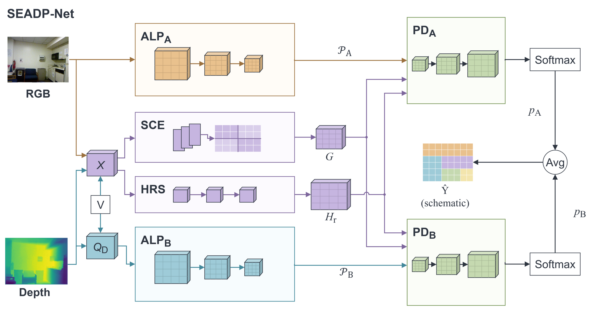
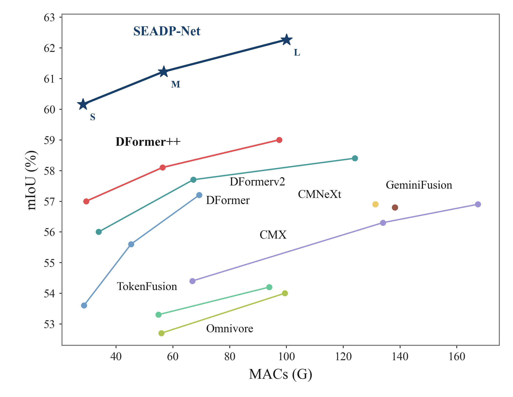

# SEADP-Net

**共享编码器非对称双金字塔网络**（Shared-Encoder Asymmetric Dual-Pyramid Network），面向 RGB-D 语义分割。

[English](README.md) | 中文

[](https://zenodo.org/doi/10.5281/zenodo.23294255)

<p align="center">
  <br>
  <em>共享 RGB-D 上下文编码器（SCE）与高分辨率主干（HRS）同时供给两个非对称
  局部金字塔（ALP_A 输入 RGB，ALP_B 输入深度）与两个解码器；推理时两头概率以
  固定 0.5/0.5 均值融合。</em>
</p>

SEADP-Net 将一个完整的 RF-DETR SegSmall ViT-S 编码器（12 个 block、宽度 384、patch 12）作为共享 RGB-D 上下文编码器，加入 stride-4 高分辨率主干，并用两个**非对称**局部金字塔解码——RGB 分支（A）与更深的深度分支（B，输入为 `[填补深度, 原始传感器有效掩码, 深度梯度幅值]`）。训练以等权交叉熵分别监督两个头；推理以固定 0.5/0.5 概率均值融合两头。没有可学习门控、没有点云模块、也没有额外的几何注意力。S / M / L 共用同一编码器，仅通过编码器输入尺度（0.5 / 0.75 / 1.0）、局部宽度、重复深度与解码器宽度区分。

## 结果

| 数据集 | 版本 | 参数量 | SS mIoU | MS5+flip mIoU |
|---|---|---:|---:|---:|
| NYUv2（40 类）| S | 26.25 M | 58.27 | 60.16 |
| NYUv2（40 类）| M | 28.95 M | 60.13 | 61.22 |
| NYUv2（40 类）| L | 29.82 M | 60.94 | 62.27 |
| SUN RGB-D（37 类）| S | 26.25 M | 52.76 | 53.69 |
| SUN RGB-D（37 类）| M | 28.95 M | 53.83 | 54.66 |
| SUN RGB-D（37 类）| L | 29.82 M | 54.76 | 55.28 |

<p align="center">
  <br>
  <em>NYUv2 mIoU（MS5+flip）与单次前向 MACs。SEADP-Net（五角星）为发布权重；
  对比值取各论文报告数字。连线仅连接各家族 S/M/L 尺寸。</em>
</p>

完整溯源——权重 SHA256、平均窗口、快照更新号、逐头成绩与评测记录——见
[`model_zoo.json`](model_zoo.json) 与 [`eval_records/`](eval_records)（本代码库
重跑的 SS/MSF 输出；每个数字均与冻结记录一致，最大 |偏差| 0.0005，唯一例外是一例
跨 GPU +0.005，已在
[`docs/equivalence_verification.md`](docs/equivalence_verification.md) 说明）。

## 安装

Python ≥ 3.11、PyTorch ≥ 2.4（在 2.8.0+cu128 上验证），以及钉定在上游 commit
`e96a71476bf09c738fa861c3d1ee2c8caeaa5ffe`（版本串 1.11.0.dev0）的 RF-DETR 包。

```bash
pip install -r requirements.txt   # 冻结的参考环境
git clone https://github.com/roboflow/rf-detr && cd rf-detr
git checkout e96a71476bf09c738fa861c3d1ee2c8caeaa5ffe && pip install -e .
cd .. && pip install -e .         # seadpnet
```

还需要固定的预训练骨干文件 `rf-detr-seg-small.pt`
（SHA256 `6de3da31b2572cac214a1c76cce4a92a13966d56390ac2b3a3de9a8dc2b2bca3`），
可从 RF-DETR 发布页获取；下文所有命令都通过 `--rf-checkpoint` 指定其位置。

## 模型库（Model zoo）

| 文件 | 数据集 / 版本 |
|---|---|
| `weights/seadp-net-nyuv2-s.pth` | NYUv2 S |
| `weights/seadp-net-nyuv2-m.pth` | NYUv2 M |
| `weights/seadp-net-nyuv2-l.pth` | NYUv2 L |
| `weights/seadp-net-sunrgbd-s.pth` | SUN RGB-D S |
| `weights/seadp-net-sunrgbd-m.pth` | SUN RGB-D M |
| `weights/seadp-net-sunrgbd-l.pth` | SUN RGB-D L |

每个文件都是三个列出中间快照的 FP32 等权参数平均（单模型推理产物，不是输出集成），
元数据已脱敏；张量字节与对应训练平均产物逐位一致（双重 SHA256 记录在
`model_zoo.json`）。六个权重均已附于 [v1.0.0 发布](https://github.com/forever678-arch/SEADP-Net/releases/tag/v1.0.0)；
下载后请按 `model_zoo.json` 中的 SHA256 校验。

## 数据准备

不分发数据集本体；准备工具会下载官方来源（SHA256 钉死）并复现完全一致的处理后目录。

```bash
# NYUv2 —— 先把五个钉定来源文件放到 data/nyuv2/raw/
python tools/prepare_nyuv2.py --root data/nyuv2
python tools/extract_nyuv2_depth.py --root data/nyuv2
python tools/prepare_nyuv2_validity.py --data-root data/nyuv2 --out data/nyuv2/nyuv2_raw_validity

# SUN RGB-D —— 自包含，官方压缩包可断点续传下载
python tools/prepare_sunrgbd.py data/sunrgbd_processed
```

来源校验和与目录契约详见 [`docs/data_preparation.md`](docs/data_preparation.md)。

## 评测

```bash
# 单尺度
python tools/evaluate_nyuv2.py --checkpoint weights/seadp-net-nyuv2-l.pth \
    --rf-checkpoint /path/rf-detr-seg-small.pt \
    --data-root data/nyuv2 --valid-root data/nyuv2/nyuv2_raw_validity \
    --split test --out nyu_l_ss.json

# 5 尺度 + 翻转
python tools/evaluate_sunrgbd.py --checkpoint weights/seadp-net-sunrgbd-m.pth \
    --rf-checkpoint /path/rf-detr-seg-small.pt \
    --data-root data/sunrgbd_processed \
    --scales 0.5 0.75 1.0 1.25 1.5 --flip --out sun_m_msf.json
```

`load_experiment` 依据 checkpoint 自带 config 重建模型、精确比对架构元数据并以
`strict=True` 加载权重；`--rf-checkpoint` 只覆盖固定预训练文件的位置。逐视图
顺序（FP32 logits → 反翻转 → resize → 裁剪 → softmax → 视图平均 → 0.5/0.5 头
融合 → argmax，全 split 累积混淆矩阵）规定于
[`docs/evaluation_protocol.md`](docs/evaluation_protocol.md) —— 不要调换顺序。

## 训练

```bash
python tools/train_nyuv2.py --config configs/nyuv2/seadp-net-l.yaml --run-dir runs/nyu_l
python tools/train_sunrgbd.py --config configs/sunrgbd/seadp-net-m.yaml --run-dir runs/sun_m
```

训练入口逐字保留原始训练数学：每个 AdamW 步对应一个有效 batch-32 更新
（微批 CE **求和**后除以整批有效像素数）、BF16 前向 + FP32 CE、带 500 步 warmup
的余弦 LR、梯度裁剪 0.1；LR 分组规则为仅 `backbone.*encoder*`（且不含 `depth`）
的参数使用骨干学习率。快照平均使用 `tools/average_checkpoints.py`。

**如实披露**：训练期模型选择监控的是官方**测试集**的固定子集（NYUv2
`test_sub100`、SUN `test_sub500`）；它们不是独立验证集。

## 推理

```bash
python tools/infer.py --checkpoint weights/seadp-net-sunrgbd-l.pth \
    --rf-checkpoint /path/rf-detr-seg-small.pt --dataset sunrgbd \
    --rgb sample/rgb.jpg --depth sample/depth.png --valid sample/valid.png \
    --out-seg seg.png --out-color seg_color.png
```

`depth.png` 为 uint16 毫米（或 float32 米制 `.npy`）；`valid.png` 在原始传感器
有效回波处非零。

## 仓库结构

```text
SEADP-Net/
  seadpnet/                  包本体
    blocks.py                几何、ChannelNorm、解码器基础块
    csp.py                   CSP 风格局部金字塔（自实现）
    dual_head_model.py       共享编码器 + HR 主干 + 双解码器图
    scaled_encoder_model.py  S/M 构建（编码器输入缩放，保留 12 层）
    encoder_retention.py     完整编码器保留审计元数据
    model.py                 三种 checkpoint 格式的加载器
    losses.py                双 CE（整批有效像素分母）
    rf/                      RF-DETR 适配层 + vendored 语义封装
    data/                    NYUv2 / SUN RGB-D 数据加载、类别元数据
    evaluation/              SS / MSF 协议、指标、SUN 原生 GT 评测
  configs/                   nyuv2/{s,m,l}.yaml、sunrgbd/{s,m,l}.yaml
  tools/                     训练 / 评测 / 推理 / 平均 / 导出、
                             prepare_{nyuv2,sunrgbd} 数据管线
  tests/                     原始代码 vs 本包等价性测试
  docs/                      架构图、协议、数据准备、验证记录
  eval_records/              六权重验证评测 SS/MSF 输出
  model_zoo.json             权重、双重 SHA256、溯源、成绩
  weights/                   本地发布权重（gitignored；见模型库）
```

## 验证

本包已在训练服务器上对照原始训练代码验证：六个正式权重逐位加载一致（参数相同、
逐头 logits 零差异、混淆矩阵相等）、训练入口逐字节复现原始首个增强批次、SS/MSF
全量重跑与所有记录数字一致。详见
[`docs/equivalence_verification.md`](docs/equivalence_verification.md)。

代码与权重元数据中的 checkpoint 格式串（如 `c11-csp-local-v1`）是继承自训练谱系
的内部加载键，不是模型名。

## 许可与引用

代码以 [MIT 许可证](LICENSE) 发布。预训练骨干与第三方组件仍遵循其自身许可
（Apache-2.0，见 [`THIRD_PARTY_NOTICES.md`](THIRD_PARTY_NOTICES.md)）。
每个发布版本均在 Zenodo 存档：[10.5281/zenodo.23294255](https://zenodo.org/doi/10.5281/zenodo.23294255)。

## 致谢

共享编码器基于 [RF-DETR](https://github.com/roboflow/rf-detr)（Apache-2.0，
含 SegSmall 预训练权重）及其 DINOv2 骨干（Apache-2.0）；见
[`THIRD_PARTY_NOTICES.md`](THIRD_PARTY_NOTICES.md)。局部 CSP 设计为受 C3k2
风格拆分/拼接块启发的自实现，不包含 Ultralytics 代码。
